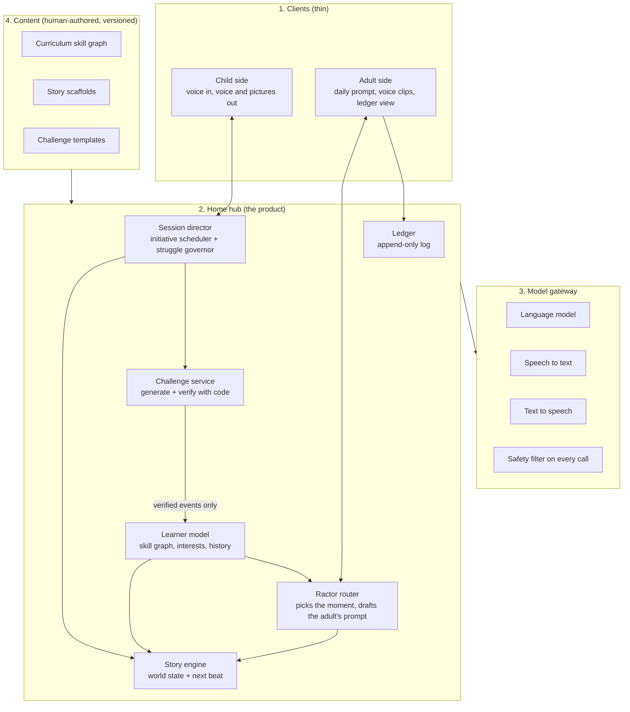

# Reference architecture

Four layers, with one loop running through them.

## 1. Clients (thin)

- **Child side:** voice in, voice and pictures out. No chat box, no browser.
- **Adult side:** the daily prompt, a voice clip recorder and the ledger view.

A tablet and a phone are the cheapest way to start. A dedicated story box or e-ink book is a later decision. See [risks and objections](05-risks-and-objections.md) for why the form matters.

## 2. Home hub (the product)

- **Session director:** runs the initiative scheduler and struggle governor as policies.
- **Story engine:** holds world state and chooses the next story beat.
- **Challenge service:** generates problems and checks them with code.
- **Learner model:** skill graph, interests, history.
- **Ractor router:** picks the moment, drafts the adult's prompt, feeds their reply back into the story.
- **Ledger:** append-only log of everything said and done.

Everything in this layer sits in one family-owned store with encrypted backup and full export. Ideally it runs on a box at home, not in someone's cloud.

## 3. Model gateway

- Language model, speech-to-text, text-to-speech.
- Local where the hardware allows, cloud otherwise with identity stripped.
- Swappable, with a safety filter on every call in and out.

## 4. Content (human-authored, versioned)

- Curriculum skill graph for reading and maths.
- Story scaffolds and challenge templates.

## The daily loop

1. The scheduler opens the session.
2. The story engine picks a beat gated by a skill.
3. The challenge service issues the problem and verifies the answer.
4. The governor decides: hint, retry or retreat.
5. The learner model updates.
6. The ractor router sends the adult one prompt.
7. The adult's answer shapes tomorrow's story.

## Three rules

1. The model never judges correctness. Code does.
2. The model never writes to the learner model directly. Only verified events do.
3. The child never gets an open chat box.
