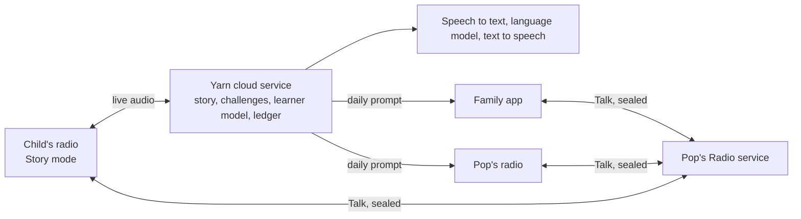

# Yarn on Pop's Radio

Yarn will be built as an extension to [Pop's Radio](https://github.com/cgbarlow/popsradio): a live, interactive story on the radio, run by a cloud service, with the family involved through the radio's own features.

Written against the Pop's Radio design as locked on 16 November 2026. Nothing in either project is built yet.

## Decisions

1. **Yarn is an extension to Pop's Radio, with its own rules.** It is not a store app and is not bound by the app rules in the platform brief. It can use the microphone and the orange button.
2. **It is live and interactive.** The child talks to the story and the story responds, as in the [bridge and troll example](04-how-it-is-used.md). A story that only plays is not the Primer.
3. **It is a cloud service.** This replaces the home hub in the [reference architecture](03-architecture.md) for this build. The family can still export or delete everything.
4. **The family is in the loop,** using Talk, the family app and Pop's own radio.

## Why the radio suits it

It is a single-purpose object with a speaker, a microphone, knobs and a one-colour screen. It is something you use, not someone you know. And it already connects the child to the people who love her.

## A session

1. She turns the Mode knob to **Story**. The narrator picks up yesterday's chapter.
2. Her character reaches a bridge. The troll will only lower it if 12 coins are shared fairly between 3 travellers. The screen shows twelve coins.
3. She holds the orange button and answers out loud.
4. The service turns her speech into a value and code checks it. She's wrong, so the troll laughs and the bridge stays up. A character drops a hint.
5. Second try, she gets it. The bridge lowers and the chapter ends on a hook.
6. The radio goes quiet. One prompt goes to an adult.

## Using the radio's features

| Feature | Job in Yarn |
|---|---|
| **Mode knob** | Story is a stop on the knob, switched on by the family |
| **Orange button** | In Story, hold to answer the story. Push-to-talk gives clean turns and no always-listening microphone |
| **Red light** | On whenever the microphone can hear, as on every Pop's Radio |
| **Select knob** | Ask for a hint, replay the last line, make story choices. Also the fallback: if her answer wasn't heard clearly, she can dial it |
| **Volume knob press** | Pause the story |
| **Screen** | One-colour illustrations and the problem itself: twelve coins, three travellers |
| **Talk** | The story hands over: "tell Grandad how you got across". Her next press goes to him, and his reply comes back through the same speaker |
| **Messages on Pop's screen** | The daily prompt, in large type with a chime |
| **Family app** | The adult side: prompts, the ledger, recording a voice clip for the story, buying a story arc |
| **Incoming message wins** | A call from the family pauses the story, like everything else on the radio |
| **On its back** | Two-player challenges, one knob each, for a sibling or a parent |
| **Bluetooth keyboard** | Later: typing and writing quests |

## The family

**Pop as the ractor.** His radio shows:

> Ask her how she'd share 12 biscuits between 4.

He turns to her name, holds the orange button and asks. She hears her great-grandad on her radio. It fills the empty chair and gives him a job worth having.

**Listening together.** Later: Pop's radio plays the same chapter at the same time, and either of them can answer. Story time with Grandad, from the next town.

**Reading aloud goes to a person.** The quest is "read this page to Grandad". She holds the button and reads. He listens. Software doesn't need to judge it.

**Rules for Pop's side:**

1. Off until Pop says yes, switched on with him there.
2. One prompt a day at most, at a time he chooses.
3. He can ignore it. Nothing tells the family he did.
4. It never tests or scores him.

## How the service fits

- **Two kinds of audio, kept apart.** Talk between people stays sealed, and the Pop's Radio service still can't open it. What she says to the story goes to the Yarn service, which has to hear it to answer. The radio should say which is which.
- **The three Yarn rules still hold.** Code judges correctness, not the model. Only verified events update the learner model. There is no open chat: the story decides what can be asked.
- **A safety filter sits on every model call,** in and out.

## Which radio is the child's?

- **A second Pop's Radio** in her home works from Stage 2 and shares a channel with Pop's.
- **The kids' mini phone** on the roadmap is the natural home, if it keeps a microphone, a knob, the screen and the speaker.

## Worth keeping from Pop's Radio, by choice

Yarn isn't bound by these, but they are why a family would trust the radio:

1. The red light is on whenever the microphone can hear.
2. The microphone only opens by a hand on the radio.
3. Nothing to buy at the radio.
4. A message from the family always wins.

## Risks

- **Children's speech.** Recognition is weaker for young voices, and code-checked answers depend on it. The knob fallback helps. Test this first.
- **Speed.** A live story has to answer in a second or two or it stops feeling like a conversation.
- **Live model, young listener.** Nothing is previewed, so the filter, the ledger and tight story scaffolds carry the safety load.
- **Running costs.** Every session costs model time. A story arc bought once in the family app, priced to cover itself, keeps "no subscription, ever" and gives the story an ending.
- **Scope.** Pop's Radio is at Stage 1. Yarn belongs in the "Later" rows until the radio exists.
- **Two audiences.** A child's radio wants different sounds, words and limits than Pop's. Session caps and a quiet time are new.

## Cheapest first test

A phone or laptop standing in for the radio: push to talk, one chapter, three spoken challenges, the real speech and language models. It answers the two riskiest questions before any hardware exists. Does it understand a seven-year-old, and does she come back for chapter two?
