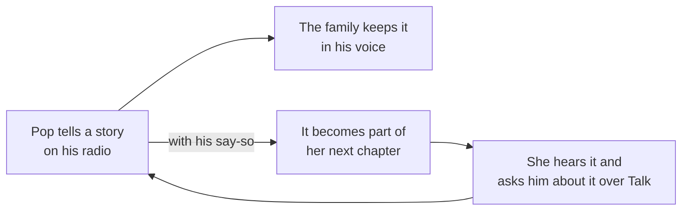

# Parents and elders

Two extensions to the idea. Yarn is as much for the adults as the child, and older people can be storytellers as well as listeners.

## A framework for parents

Yarn gives parents a simple way to be more engaged with their kids. It is the best-evidenced part of the idea: StoryMate parents said the tool helped them ask better questions, and the Stanford text tips worked with nothing more than well-aimed prompts. See [prior art](06-prior-art.md).

**The habit it teaches**

1. **Notice.** Yarn tells the parent in plain words what she is working on.
2. **Ask.** One question a day, tied to that day's story.
3. **Wait.** Give her time. Don't hand over the answer.
4. **Ask how.** "How did you work that out?"

**The weekly rhythm**

- A question most days, at dinner or over Talk
- One thing to do together at the weekend
- A cold check on paper every few weeks

**Rules**

- **A framework, never a scorecard.** No streaks, no "you missed three days", no engagement rating for parents. Guilt would kill it faster than boredom.
- **The prompts fade for the parent too.** Success is a parent who notices and asks without being told.
- **Learning only.** Comfort, discipline and values are never Yarn's job. See [risks and objections](05-risks-and-objections.md).

## Stories for older people

Two versions. The second is the stronger one.

**Listening.** A story or serial on the radio each evening. Pleasant, but internet radio and audiobooks already do it.

**Telling.** The radio asks Pop about his first job or the house he grew up in. He holds the button and tells it. The family keeps his stories in his own voice.

### Joining the two halves

Pop's real stories become material for the child's chapters. The bridge the troll guards is the one he helped build. That puts a person who loves her inside the story, which is the closest thing to Miranda in the design.

### Rules for elders

They are not the child's rules.

- **No testing, scoring or curriculum.**
- **No fade and no ending.** Nobody is trying to make Pop need it less.
- **Recording only with his say-so.** He decides who hears what, and which stories go into a child's chapter.
- **No health claims.** It is company and storytelling, not therapy.
- **The red light is on whenever the microphone can hear,** as on every Pop's Radio.

## Order of work

This is a third audience on a project with nothing built. Children come first. Pop's storytelling can come early, because it only needs the button and a recorder.

## Open questions

- Does Pop want to be asked, and how often?
- Who chooses which of his stories reach a child, and how are they checked first?
- Where his recordings live, who can hear them, and what happens to them later.
- Whether prompts for parents should come from the family app, the radio, or both.
